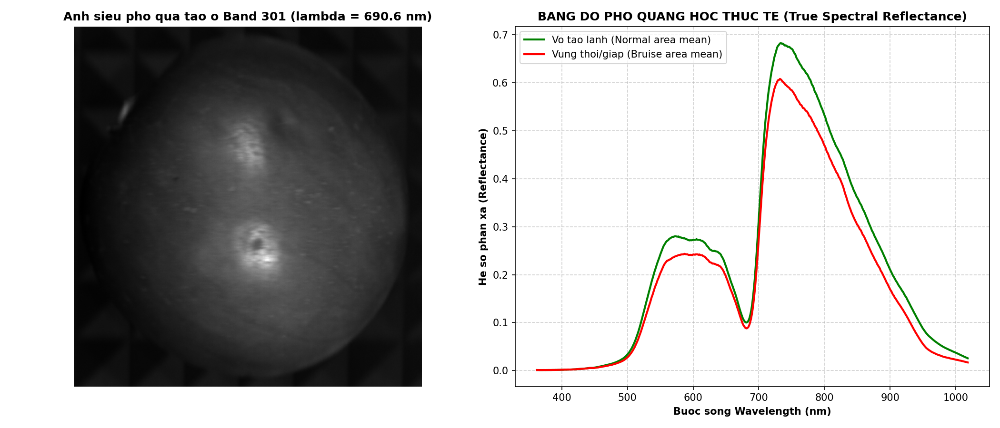
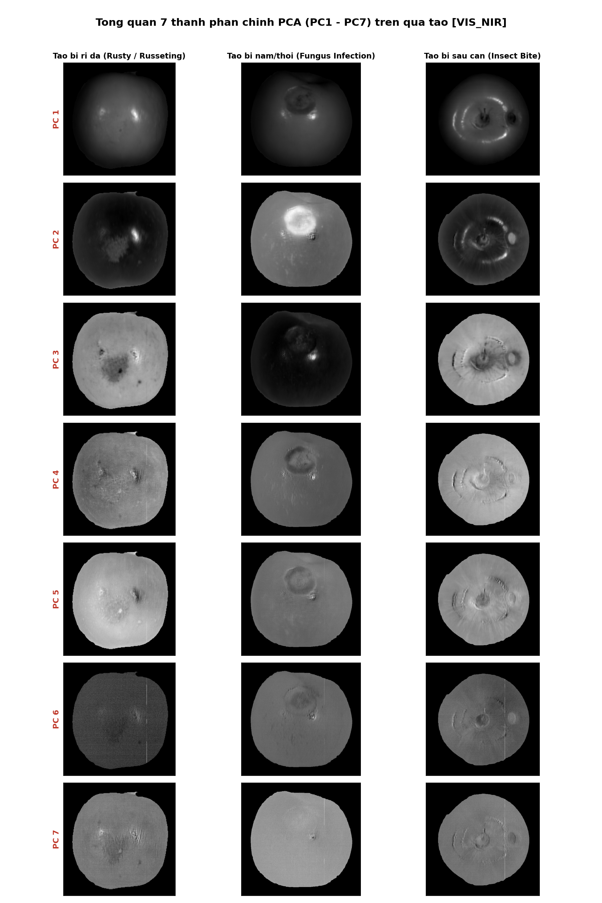
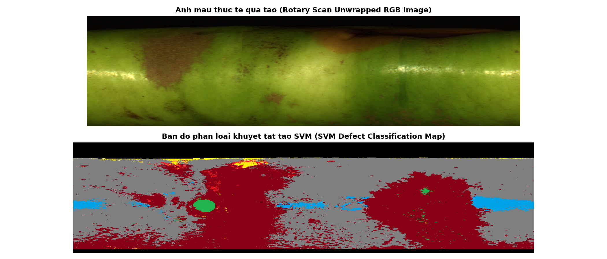

# Apple Surface Defect Detection using Hyperspectral Imaging (HSI) & PCA
### Dự án Fruitscan - Kiểm soát chất lượng nông sản bằng ảnh siêu phổ & AI

> [!IMPORTANT]
> **LƯU Ý / DISCLAIMER:**  
> **Đây là bản kiểm tra tính xác thực sơ bộ (Check Legit / Preliminary Verification), KHÔNG PHẢI là bản nộp chính thức cuối cùng (Final Version).**  
> Bản phát hành này phục vụ mục đích rà soát đối chứng dữ liệu thực nghiệm, kiểm tra tính toàn vẹn của mã nguồn và thuật toán trước khi hoàn thiện hồ sơ dự án.



---

## 📌 Tổng quan dữ liệu (Data Overview)

Dự án bao gồm 2 nhóm dữ liệu quang phổ cốt lõi:

### 1. Dữ liệu 7 thành phần chính PCA (`data/pca_data/`)
- **File**: `vis_nir.mat` và `nir.mat`
- **Ý nghĩa**: Ma trận kết quả sau khi áp dụng giải thuật **Principal Component Analysis (PCA)** lên khối siêu phổ của quả táo.
- **7 kênh**: Tương ứng với **PC1, PC2, ..., PC7** giải thích độ biến thiên quang phổ của các khuyết tật:
  - `rusty`: Táo bị rỉ da / da cám (Russeting)
  - `fungus_infection`: Táo bị nấm thối (Fungus Decay - tương phản cực mạnh ở PC2)
  - `insect_bite`: Táo bị vết sâu cắn / côn trùng đục (Insect Bite)
- **Kích thước**: ~`500-600 x 500-600 x 7` kênh PC.



### 2. Khối siêu phổ 600 bước sóng (`data/hsi_cube/`)
- **File**: 
  - `HSIdata20_r1.mat` (Bản đầy đủ: 401 MB, 600 kênh x 571 x 551).
  - `HSIdata20_sample.mat` (Bản nén tối ưu: 75 MB - thân thiện với GitHub).
- **Ý nghĩa**: Khối dữ liệu siêu phổ HSI đo phản xạ thực tế qua **600 bước sóng liên tục** (từ `361.8 nm` đến `1018.4 nm`).
- **Các vùng chọn (Masks)**:
  - `mask_object`: Vùng toàn bộ quả táo.
  - `mask_normal`: Vùng vỏ táo bình thường (vỏ lành).
  - `mask_bruise`: Vùng khuyết tật / thâm giập trên quả táo.
- **Đặc trưng quang phổ**: Thể hiện rõ đặc tính quang phổ thực vật: vùng hấp thụ diệp lục (~680 nm) và bước nhảy Red-edge (700 - 750 nm).

### 3. Ảnh quét mở phẳng & Bản đồ phân loại SVM (`data/scan_images/`)
- `colorimage.bmp`: Ảnh quét quay tròn 360 độ mở phẳng của quả táo (Rotary scan unwrapped).
- `SVM_7_topbottom_1603.bmp`: Bản đồ phân loại bề mặt khuyết tật quả táo bằng mô hình SVM 7 lớp.



---

## 📂 Cấu trúc thư mục (Repository Structure)

```
Apple_HSI_Defect_Project/
├── data/
│   ├── pca_data/
│   │   ├── vis_nir.mat             # 7 PCs PCA khuyết tật táo (VIS-NIR)
│   │   └── nir.mat                 # 7 PCs PCA khuyết tật táo (NIR)
│   ├── hsi_cube/
│   │   ├── HSIdata20_sample.mat    # Khối siêu phổ mẫu 600 bands (<100MB cho GitHub)
│   │   └── HSIdata20_r1.mat        # Khối siêu phổ đầy đủ 600 bands (Git LFS)
│   ├── scan_images/
│   │   ├── colorimage.bmp          # Ảnh quét quay tròn mở phẳng RGB
│   │   └── SVM_7_topbottom_1603.bmp# Bản đồ phân loại lỗi bằng SVM
│   └── calibration/
│       ├── factor_aca1920_155um_03_2020.mat # Hệ số bước sóng Basler camera
│       └── factor.mat
├── matlab/
│   ├── images.m                    # Script MATLAB xem 7 PC của các khuyết tật
│   ├── HSI_PCA.m                   # Hàm tính toán phân tích thành phần chính PCA
│   ├── band_wave.m                 # Hàm tính bước sóng từ hệ số hiệu chuẩn
│   ├── checkmask.m                 # Kiểm tra các lớp mask quả táo
│   ├── Processing_HSIdata_step1.m  # Pipeline tạo khối HSI từ ảnh quét dòng
│   └── Processing_HSIdata_step9.m  # Pipeline trích xuất thành phần PCA
├── python/
│   ├── view_apple_data.py          # Trình xem tương tác Python (PCA 7 PCs & HSI 600 bands)
│   └── run_viewer.bat              # Script khởi chạy nhanh trong thư mục python/
├── docs/                           # Hình ảnh minh họa & kết quả xuất
├── run_viewer.bat                  # Script nhấp đúp khởi chạy ngay trên Windows
├── requirements.txt                # Danh sách thư viện Python cần thiết
├── .gitattributes                  # Cấu hình Git LFS cho các file dữ liệu lớn
├── .gitignore                      # Danh sách file bỏ qua khi commit Git
└── README.md                       # Tài liệu hướng dẫn dự án
```

---

## 🚀 Hướng dẫn cài đặt và sử dụng

### 1. Môi trường yêu cầu
Khuyến nghị sử dụng môi trường Conda đã cài sẵn các thư viện HSI (ví dụ môi trường `hsi`):

```bash
conda activate hsi
pip install -r requirements.txt
```

### 2. Khởi chạy Trình xem tương tác (Viewer)

#### Cách 1: Chạy bằng Terminal
```bash
conda activate hsi
python python/view_apple_data.py
```

#### Cách 2: Chạy trực tiếp trên Windows
Nhấp đúp chuột vào file **`run_viewer.bat`** ở thư mục gốc của dự án.

### 3. Các tính năng chính của Viewer
- **Chế độ PCA (7 PCs)**:
  - Thanh trượt Slider chuyển đổi giữa **PC1 đến PC7**.
  - Xem đồng thời 3 dạng khuyết tật: Rỉ da (Rusty), Nấm thối (Fungus), Sâu cắn (Insect Bite).
  - Click chuột vào quả táo để hiển thị **Biểu đồ cột PCA Scores (PC1 - PC7)** tại điểm pixel.
  - Nút chuyển đổi hiển thị ảnh màu RGB và Bản đồ phân loại SVM.
- **Chế độ HSI (600 Bands)**:
  - Thanh trượt Slider quét qua **600 kênh bước sóng** (từ `362 nm` đến `1018 nm`).
  - Xem ảnh siêu phổ tại bước sóng đang chọn kèm lớp Mask (vỏ lành màu xanh, vết giập màu đỏ).
  - Click chuột vào quả táo để đo **BẢNG ĐỒ PHỔ QUANG HỌC THỰC TẾ** (Reflectance Spectrum) và so sánh trực tiếp với đường phổ trung bình của vỏ lành vs vỏ bệnh.

---

## 📤 Hướng dẫn đẩy lên GitHub (Push to GitHub)

### Lưu ý về kích thước file (> 100 MB):
GitHub có giới hạn dung lượng **100 MB** cho mỗi file khi push thông thường:
- Thư mục đã tạo sẵn file `HSIdata20_sample.mat` (**75 MB**) để có thể push trực tiếp lên GitHub mà không bị lỗi dung lượng.
- Nếu muốn push cả file gốc `HSIdata20_r1.mat` (**401 MB**), bạn cần cài đặt **Git LFS** (dự án đã cấu hình sẵn `.gitattributes`):

```bash
# 1. Cài đặt Git LFS (chỉ cần làm 1 lần trên máy)
git lfs install

# 2. Khởi tạo Git repository trong thư mục Apple_HSI_Defect_Project
cd Apple_HSI_Defect_Project
git init

# 3. Thêm file và commit
git add .
git commit -m "Initial commit: Apple HSI & PCA Defect Detection Project"

# 4. Liên kết với repository GitHub của bạn và push
git branch -M main
git remote add origin https://github.com/USERNAME/REPO_NAME.git
git push -u origin main
```

*(Nếu không sử dụng Git LFS, bạn có thể xóa hoặc thêm `data/hsi_cube/HSIdata20_r1.mat` vào `.gitignore`, trình xem sẽ tự động sử dụng file `HSIdata20_sample.mat` để chạy bình thường).*
